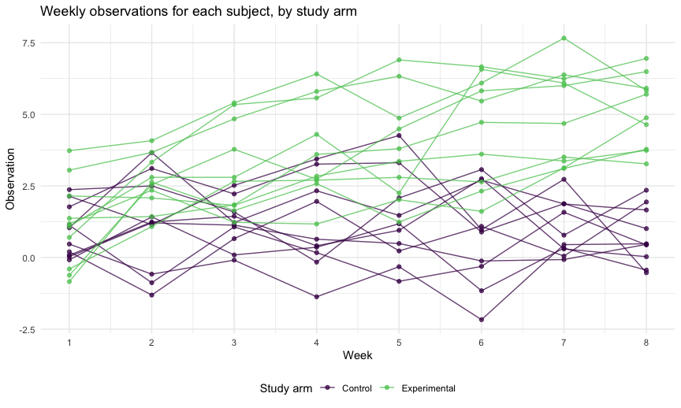

Homework 5 (p8105)
================
Sanyu Takirambudde (stt2133)
2026-11-18

## Problem 1: Shared birthdays

The `shared_bday` function below randomly samples $n$ birthdays from 365
equally likely days and returns `TRUE` if at least one birthday is
repeated.

``` r
shared_bday = function(n) {
  bdays = sample(1:365, size = n, replace = TRUE)
  repeated_bday = length(unique(bdays)) < n
  return(repeated_bday)
}
```

Next, I run the function 10,000 times for each group size from 2 to 50
and average the results to estimate the probability of a shared
birthday.

``` r
set.seed(1118)

bday_sim =
  expand_grid(
    group_size = 2:50, 
    iter = 1:10000
  ) |>
  mutate(
    repeated = map_lgl(group_size, shared_bday))

bday_results =
  bday_sim |>
  group_by(group_size) |>
  summarize(prob_of_repeat = mean(repeated))
```

``` r
bday_results |>
  ggplot(aes(x = group_size, y = prob_of_repeat)) +
  geom_point() +
  geom_line() +
  labs(
    title = "Simulated probability that at least two people share a birthday",
    x = "Group size (number of people)",
    y = "Probability of a shared birthday",
    caption = "Based on 10,000 simulated groups per group size"
  )
```


The probability of a shared birthday rises quickly and non-linearly with
group size. It is near zero for very small groups (0.0032 with 2
people), crosses 0.5 at a group size of 23, and reaches 0.9692 with 50
people.

## Problem 2: Longitudinal study

### Import data

``` r
study_files =
  tibble(
    file_name = list.files("data/")
  ) |>
  mutate(
    path = str_c("data/", file_name),
    data = map(path, read_csv)
  )
```

### Tidy data

``` r
study_df =
  study_files |>
  mutate(file_name = str_remove(file_name, "\\.csv$")) |>
  separate(file_name, into = c("arm", "subject_id"), sep = "_") |>
  mutate(
    participant = str_c(arm, subject_id, sep = "-"),
    arm = case_match(
      arm,
      "con" ~ "Control",
      "exp" ~ "Experimental"
    ),
    arm = factor(arm, levels = c("Control", "Experimental")),
    subject_id = as.numeric(subject_id)
  ) |>
  unnest(data) |>
  pivot_longer(
    week_1:week_8,
    names_to = "week",
    names_prefix = "week_",
    values_to = "observation"
  ) |>
  mutate(week = as.numeric(week)) |>
  select(-path)
## Warning: There was 1 warning in `mutate()`.
## ℹ In argument: `arm = case_match(arm, "con" ~ "Control", "exp" ~
##   "Experimental")`.
## Caused by warning:
## ! `case_match()` was deprecated in dplyr 1.2.0.
## ℹ Please use `recode_values()` instead.
```

### Spaghetti plot

``` r
study_df |>
  ggplot(aes(x = week, y = observation, group = participant, color = arm)) +
  geom_line(alpha = 0.75) +
  geom_point(alpha = 0.75) +
  facet_grid(. ~ arm) +
  scale_x_continuous(breaks = 1:8) +
  labs(
    title = "Weekly observations for each subject, by study arm",
    x = "Week",
    y = "Observation",
    color = "Study arm"
  )
```



At week 1, the two arms look similar, with overlapping values. The
experimental arm generally shows increasing observations over time,
whereas the control arm fluctuates without a consistent upward trend.
Over the 8 weeks, subjects in the experimental arm generally show
increasing observations over time, while control subjects stay roughly
flat around their starting level but fluctuate week to week. At week 8,
every experimental subject has a higher observation than every control
subject. There is variation between participants and from week to week
within each arm, but the groups separate more clearly over time. This
divergence between groups could suggest an effect of the experimental
condition.

## Problem 3: Power of a one-sample t-test

### Simulate samples and tests

The `t_test_sim` function below generates a dataset of size $n = 30$
from a Normal distribution with $\sigma = 5$. The function then performs
a one sample t-test of $H_0: \mu = 0$ and extracts the sample mean and
p-value.

``` r
t_test_sim = function(mu) {
  sample_data = rnorm(n = 30, mean = mu, sd = 5)

  t_test_result = 
    t.test(sample_data, mu = 0) |>
    broom::tidy() |>
    select(mu_hat = estimate, p_value = p.value)
  
  return(t_test_result)
}
```
