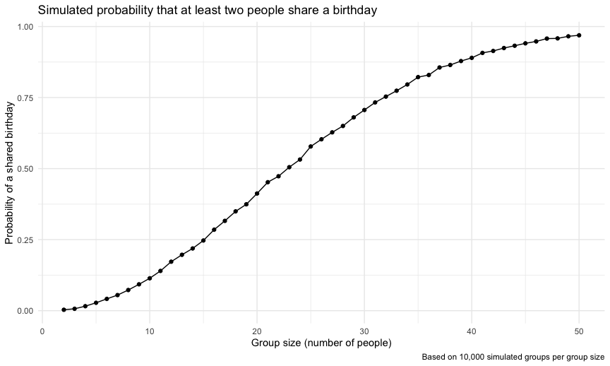
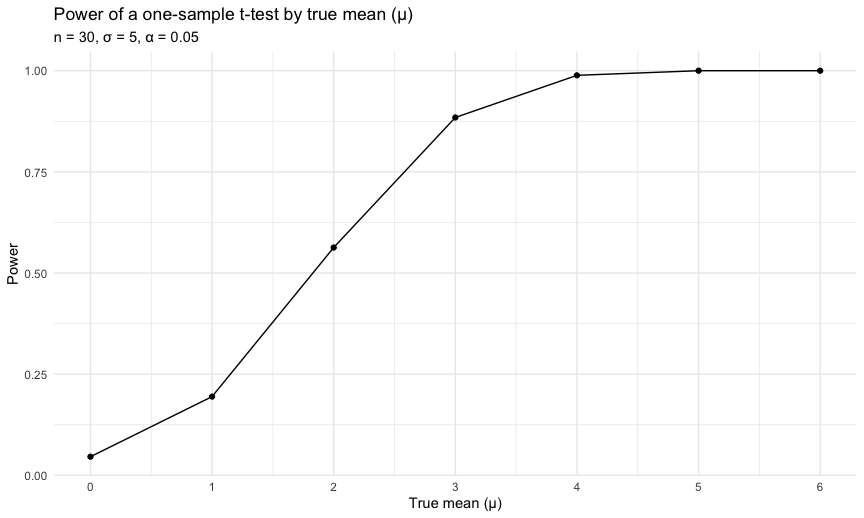
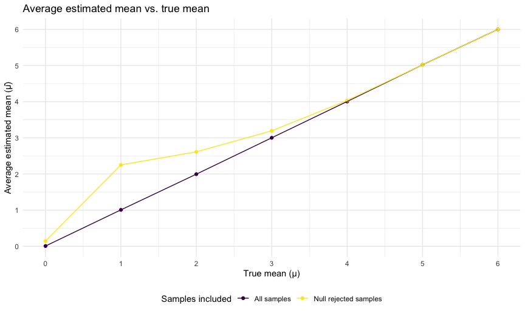

Homework 5 (p8105)
================
Sanyu Takirambudde (stt2133)
2026-11-18

## Problem 1: Shared birthdays

The `shared_bday` function below randomly samples $n$ birthdays from 365
equally likely days and returns `TRUE` if at least one birthday is
repeated.

``` r
shared_bday = function(n) {
  bdays = sample(1:365, size = n, replace = TRUE)
  repeated_bday = length(unique(bdays)) < n
  return(repeated_bday)
}
```

Next, I run the function 10,000 times for each group size from 2 to 50
and average the results to estimate the probability of a shared
birthday.

``` r
set.seed(1118)

bday_sim =
  expand_grid(
    group_size = 2:50, 
    iter = 1:10000
  ) |>
  mutate(
    repeated = map_lgl(group_size, shared_bday))

bday_results =
  bday_sim |>
  group_by(group_size) |>
  summarize(prob_of_repeat = mean(repeated))
```

``` r
bday_results |>
  ggplot(aes(x = group_size, y = prob_of_repeat)) +
  geom_point() +
  geom_line() +
  labs(
    title = "Simulated probability that at least two people share a birthday",
    x = "Group size (number of people)",
    y = "Probability of a shared birthday",
    caption = "Based on 10,000 simulated groups per group size"
  )
```



The probability of a shared birthday rises quickly and non-linearly with
group size. It is near zero for very small groups (0.0032 with 2
people), crosses 0.5 at a group size of 23, and reaches 0.9692 with 50
people.

## Problem 2: Longitudinal study

### Import data

``` r
study_files =
  tibble(
    file_name = list.files("data/")
  ) |>
  mutate(
    path = str_c("data/", file_name),
    data = map(path, read_csv)
  )
```

### Tidy data

``` r
study_df =
  study_files |>
  mutate(file_name = str_remove(file_name, "\\.csv$")) |>
  separate(file_name, into = c("arm", "subject_id"), sep = "_") |>
  mutate(
    participant = str_c(arm, subject_id, sep = "-"),
    arm = case_match(
      arm,
      "con" ~ "Control",
      "exp" ~ "Experimental"
    ),
    arm = factor(arm, levels = c("Control", "Experimental")),
    subject_id = as.numeric(subject_id)
  ) |>
  unnest(data) |>
  pivot_longer(
    week_1:week_8,
    names_to = "week",
    names_prefix = "week_",
    values_to = "observation"
  ) |>
  mutate(week = as.numeric(week)) |>
  select(-path)
## Warning: There was 1 warning in `mutate()`.
## ℹ In argument: `arm = case_match(arm, "con" ~ "Control", "exp" ~
##   "Experimental")`.
## Caused by warning:
## ! `case_match()` was deprecated in dplyr 1.2.0.
## ℹ Please use `recode_values()` instead.
```

### Spaghetti plot

``` r
study_df |>
  ggplot(aes(x = week, y = observation, group = participant, color = arm)) +
  geom_line(alpha = 0.75) +
  geom_point(alpha = 0.75) +
  facet_grid(. ~ arm) +
  scale_x_continuous(breaks = 1:8) +
  labs(
    title = "Weekly observations for each subject, by study arm",
    x = "Week",
    y = "Observation",
    color = "Study arm"
  )
```


At week 1, the two arms look similar, with overlapping values. The
experimental arm generally shows increasing observations over time,
whereas the control arm fluctuates without a consistent upward trend.
Over the 8 weeks, subjects in the experimental arm generally show
increasing observations over time, while control subjects stay roughly
flat around their starting level but fluctuate week to week. At week 8,
every experimental subject has a higher observation than every control
subject. There is variation between participants and from week to week
within each arm, but the groups separate more clearly over time. This
divergence between groups could suggest an effect of the experimental
condition.

## Problem 3: Power of a one-sample t-test

### Simulate samples and tests

The `t_test_sim` function below generates a dataset of size $n = 30$
from a Normal distribution with $\sigma = 5$. The function then performs
a one sample t-test of $H_0: \mu = 0$ and extracts the sample mean and
p-value.

``` r
t_test_sim = function(mu) {
  sample_data = rnorm(n = 30, mean = mu, sd = 5)

  t_test_result = 
    t.test(sample_data, mu = 0) |>
    broom::tidy() |>
    select(mu_hat = estimate, p_value = p.value)
  
  return(t_test_result)
}
```

``` r
set.seed(1118)

sim_results_df =
  expand_grid(
    true_mu = 0:6,
    iter = 1:5000
  ) |>
  mutate(results = map(true_mu, t_test_sim)) |>
  unnest(results) |>
  mutate(reject = p_value < 0.05)
```

``` r
power_results =
  sim_results_df |>
  group_by(true_mu) |>
  summarize(
    power = mean(reject),
    avg_mu_hat = mean(mu_hat),
    avg_mu_hat_rejected = mean(mu_hat[reject])
  )

power_results |>
  knitr::kable(digits = 3)
```

| true_mu | power | avg_mu_hat | avg_mu_hat_rejected |
|--------:|------:|-----------:|--------------------:|
|       0 | 0.046 |      0.006 |               0.143 |
|       1 | 0.195 |      1.007 |               2.250 |
|       2 | 0.563 |      1.994 |               2.612 |
|       3 | 0.884 |      3.001 |               3.194 |
|       4 | 0.989 |      4.005 |               4.033 |
|       5 | 1.000 |      5.021 |               5.021 |
|       6 | 1.000 |      6.002 |               6.002 |

### Effect size and power

``` r
power_results |>
  ggplot(aes(x = true_mu, y = power)) +
  geom_point() +
  geom_line() +
  scale_x_continuous(breaks = 0:6) +
  labs(
    title = "Power of a one-sample t-test by true mean (μ)",
    subtitle = "n = 30, σ = 5, α = 0.05",
    x = "True mean (μ)",
    y = "Power"
  )
```


Power increases with effect size. When the true mean is 0, the null
hypothesis is true and the rejection proportion is 0.046, which aligns
closely with the pre-specified type I error rate of 0.05. As the true
mean moves away from 0, the effect size ($\mu / \sigma$) increases and
the test rejects the null hypothesis more frequently. With sample size
and standard deviation held constant, a larger mean generates a stronger
signal relative to the standard error. Specifically, power rises from
0.1946 at $\mu = 1$ to 0.563 at $\mu = 2$, reaches 0.8844 at $\mu = 3$,
and approaches 1 for $\mu \ge 4$. Overall, the relationship is S-shaped
as power climbs steeply across moderate effect sizes before leveling off
near 1 once the effect is large relative to sampling variability..

### Average estimates vs. true mean

``` r
power_results |>
  select(true_mu, avg_mu_hat, avg_mu_hat_rejected) |>
  pivot_longer(
    avg_mu_hat:avg_mu_hat_rejected,
    names_to = "samples",
    values_to = "avg_estimate"
  ) |>
  mutate(
    samples = case_match(
      samples,
      "avg_mu_hat" ~ "All samples",
      "avg_mu_hat_rejected" ~ "Null rejected samples"
    )
  ) |>
  ggplot(aes(x = true_mu, y = avg_estimate, color = samples)) +
  geom_point() +
  geom_line() +
  scale_x_continuous(breaks = 0:6) +
  scale_y_continuous(breaks = 0:6) +
  labs(
    title = "Average estimated mean vs. true mean",
    x = "True mean (μ)",
    y = "Average estimated mean (μ̂)",
    color = "Samples included"
  )
```



Across all samples, the average estimated mean is approximately equal to
the true mean, as expected because the sample mean is unbiased. Among
only the samples where the null was rejected, the average estimated mean
is **not** approximately equal to the true mean which in this case is
overestimated, likely due to the low to moderate power. For example, at
$\mu = 1$ it is about 2.2499, and at $\mu = 2$ about 2.6119.

A sample only rejects $H_0: \mu = 0$ if its mean is far enough from 0.
When the true effect is small, the samples that pass that threshold are
the ones whose mean happened to land well above the truth, so
conditioning on rejection keeps the overestimates and throws away the
rest. As mu grows and power approaches 1, nearly every sample is
rejected, so the conditional average converges back to the true mean
(from $\mu \ge 4$ the two lines nearly overlap).

At mu = 0, the rejected samples are split between large positive and
large negative estimates, so their average stays near 0, but each of
those estimates is far from the truth in absolute value. Effect sizes
reported only when they are statistically significant tend to be
exaggerated, especially in underpowered studies.
